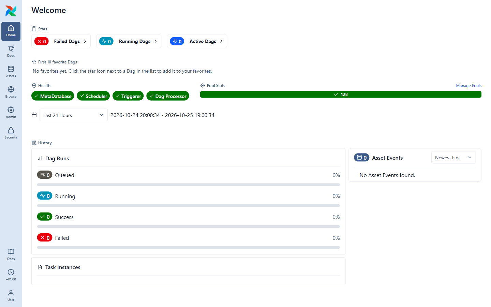

# hello-airflow 🌀

A ready-to-run **Apache Airflow 3** playground plus a step-by-step onboarding course.
Clone it, run one command, and learn Airflow by clicking through real DAGs.



## Quick start

Requirements: [Docker Desktop](https://www.docker.com/products/docker-desktop/) (or Docker Engine + Compose v2) with **at least 4 GB of RAM** allocated.

```bash
git clone <url-of-this-repo> hello-airflow
cd hello-airflow
docker compose up -d
```

Wait 1–2 minutes, then open **http://localhost:8080** and log in with **`airflow` / `airflow`**.

> 🐧 **Linux users:** run `echo "AIRFLOW_UID=$(id -u)" > .env` before the first `docker compose up`,
> so files written to `./data` belong to you and not to root.

Stop it with `docker compose down`. Start over from zero with `docker compose down && rm -rf data/*`
(keep `data/.gitkeep`).

## What's in the box

```
hello-airflow/
├── docker-compose.yaml   # Airflow 3.3 + Postgres, LocalExecutor
├── .env.example          # optional settings (copy to .env)
├── dags/                 # the tutorial DAGs - edit them, add your own
├── plugins/              # custom plugins (empty for now)
├── data/                 # gitignored: database, logs, config and files written by DAGs
└── tutorials/            # the onboarding course, start here 👇
```

| Folder on your machine | Path inside the containers | What lives there                    |
| ---------------------- | -------------------------- | ----------------------------------- |
| `dags/`                | `/opt/airflow/dags`        | Your DAG Python files               |
| `data/files/`          | `/opt/airflow/data`        | Files your tasks write (CSV, JSON…) |
| `data/logs/`           | `/opt/airflow/logs`        | Task logs                           |
| `data/postgres/`       | (postgres container)       | Airflow's metadata database         |
| `data/config/`         | `/opt/airflow/config`      | Generated `airflow.cfg`             |

## The course

| #  | Tutorial                                                              | DAG used                         |
| -- | --------------------------------------------------------------------- | -------------------------------- |
| 01 | [What is Airflow?](tutorials/01-what-is-airflow.md)                   | –                                |
| 02 | [Getting started & UI tour](tutorials/02-getting-started.md)          | –                                |
| 03 | [Your first DAG](tutorials/03-your-first-dag.md)                      | `t01_hello_airflow`              |
| 04 | [Scheduling & dates](tutorials/04-scheduling.md)                      | `t02_taskflow_etl`               |
| 05 | [TaskFlow API & XCom](tutorials/05-taskflow-and-xcom.md)              | `t02_taskflow_etl`               |
| 06 | [Data-aware scheduling with Assets](tutorials/06-assets.md)           | `t03_asset_producer` / `_consumer` |
| 07 | [Params, Variables & branching](tutorials/07-params-variables-branching.md) | `t04_params_variables_branching` |
| 08 | [Failures, retries & debugging](tutorials/08-debugging.md)            | `t05_retries_and_failures`       |
| 09 | [Cheat sheet & next steps](tutorials/09-cheatsheet.md)                | –                                |

⚠️ This setup is for learning and local development only — not for production.
