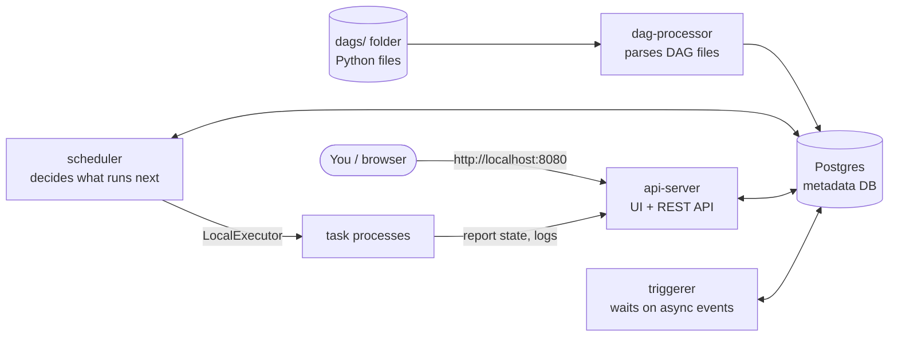

# 01 · What is Airflow?

**Apache Airflow is a platform to write, schedule and monitor workflows as Python code.**

Think of it as a very smart, very patient `cron` that:

- knows that task B must wait for task A,
- retries things that fail,
- remembers every run it ever did (and lets you re-run any of them),
- shows all of it in a web UI.

Airflow does **orchestration**: it decides *what* runs *when* and keeps track of the result.
It is not a data-processing engine itself — the heavy lifting is usually done by the systems your tasks
call (a database, Spark, an API, a Python script…).

## The vocabulary you need

| Word              | Meaning                                                                                    |
| ----------------- | ------------------------------------------------------------------------------------------ |
| **DAG**           | *Directed Acyclic Graph*. A workflow: a set of tasks and the arrows between them. No loops. |
| **Task**          | One step in a DAG ("download file", "load table").                                         |
| **Operator**      | A template for a task: `BashOperator` runs a shell command, `PythonOperator` a function…   |
| **`@task`**       | The modern way (TaskFlow API) to turn a Python function into a task.                       |
| **DAG run**       | One execution of a DAG, e.g. "the run for 2026-10-25".                                     |
| **Task instance** | One execution of one task inside one DAG run. It has a state: queued, running, success…    |
| **Schedule**      | When new DAG runs are created: a cron expression, `@daily`, an Asset, or `None` (manual).  |
| **XCom**          | Small pieces of data passed between tasks ("cross-communication").                         |
| **Asset**         | A piece of data (file, table…) that tasks produce; DAGs can be scheduled on its updates.   |
| **Connection / Variable** | Stored credentials / stored config values, managed in the UI.                      |

## How the pieces fit together

This repo's `docker-compose.yaml` starts these services:

| Service                 | Job                                                                                    |
| ----------------------- | -------------------------------------------------------------------------------------- |
| `postgres`              | The **metadata database**: every DAG, run, task state, variable… lives here.            |
| `airflow-dag-processor` | Reads the Python files in `dags/` and stores the DAG structure in the database.        |
| `airflow-scheduler`     | Creates DAG runs when they are due and sends ready tasks to the **executor**.          |
| `airflow-apiserver`     | Serves the web UI and the REST API. Tasks also talk to it to report their progress.    |
| `airflow-triggerer`     | Runs *deferrable* tasks that are waiting for something (a file, a time…) cheaply.       |
| `airflow-init`          | One-shot: migrates the database and creates the `airflow` user, then exits.            |

> **Executor?** The executor decides *where* tasks run. We use the `LocalExecutor`: tasks run as
> sub-processes of the scheduler container. In production you'd typically use Celery or Kubernetes
> executors to spread tasks over many machines — your DAG code does not change.

## Golden rules (read these now, thank yourself later)

1. **A DAG file is a definition, not a script.** The dag-processor imports your file every ~30 s to
   *discover* the DAG. Don't do heavy work (API calls, DB queries) at the top level of the file —
   put it inside tasks.
2. **Tasks should be idempotent.** Running the same task twice for the same date should give the same
   result. Retries and re-runs happen all the time.
3. **XCom is for small data.** Pass file paths or IDs between tasks, not whole datasets.
4. **Airflow orchestrates, it doesn't compute.** Push big work to the right tool and let Airflow
   start it and watch it.

➡️ Next: [02 · Getting started & UI tour](02-getting-started.md)
