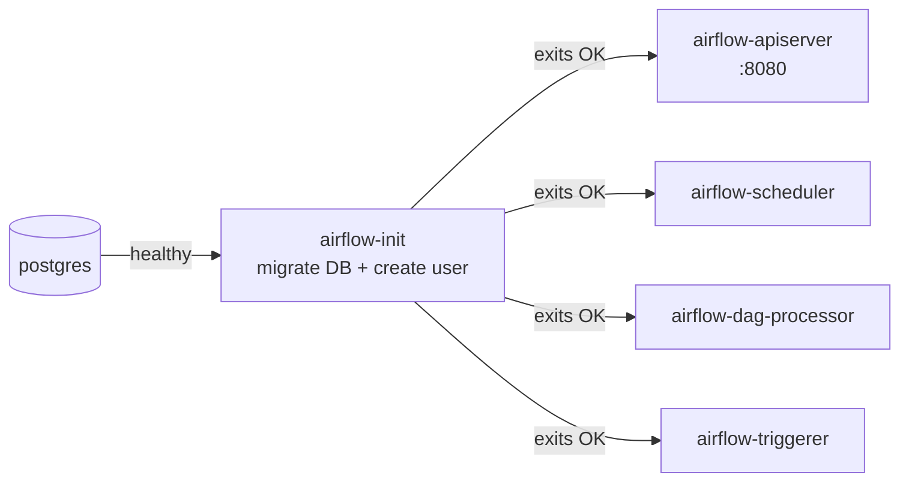
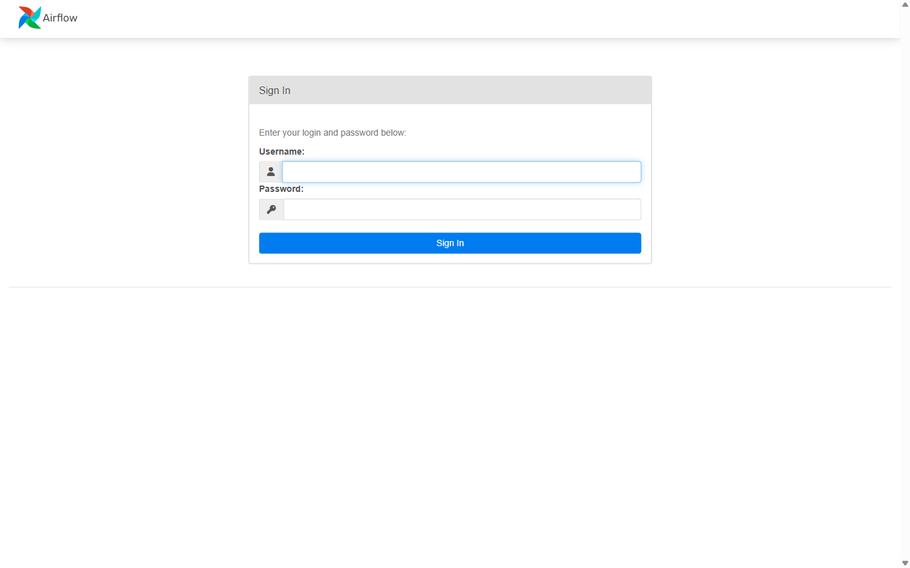
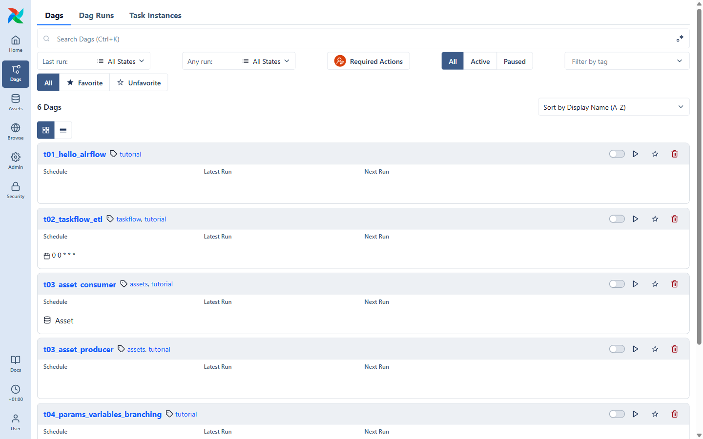

# 02 · Getting started & UI tour

## 1. Start Airflow

From the repository root:

```bash
docker compose up -d
```

The first time, Docker downloads the images (~1.5 GB) — grab a coffee ☕.
Then `airflow-init` prepares the database and exits, and the other services start:



Check that everything is up:

```bash
docker compose ps
```

You should see `postgres`, `airflow-apiserver`, `airflow-scheduler`, `airflow-dag-processor` and
`airflow-triggerer` with status **`(healthy)`**. (`airflow-init` is not listed: it already finished.)

<details>
<summary>Something looks wrong?</summary>

- `docker compose logs airflow-init` – database migration / permission problems.
- `docker compose logs -f airflow-scheduler` – live scheduler logs.
- Port 8080 already used? Change `"8080:8080"` to `"8081:8080"` in `docker-compose.yaml`.
- Containers keep restarting? Give Docker more memory (4 GB minimum).
</details>

## 2. Log in

Open **http://localhost:8080** and sign in with **`airflow` / `airflow`**.



## 3. The home page


- **Stats** – how many DAGs are failing, running, active.
- **Health** – one badge per Airflow component. All green = all good. If one is red, look at that
  container's logs.
- **Pool slots** – how many tasks can run at the same time.
- **History** – recent DAG runs and task instances by state.

The left sidebar is how you move around:

| Icon         | What you find there                                                   |
| ------------ | --------------------------------------------------------------------- |
| **Dags**     | The list of all DAGs (you'll live here)                                |
| **Assets**   | Data assets and which DAGs produce/consume them (tutorial 06)          |
| **Browse**   | All DAG runs, task instances, audit logs, XComs                        |
| **Admin**    | Variables, Connections, Pools, Providers, Plugins, Config              |
| **Security** | Users and roles                                                        |

## 4. The DAG list

Click **Dags**:



Each card is one DAG found in the `dags/` folder. For each one you see:

- its **tags** (we tagged everything `tutorial` – click a tag to filter),
- its **Schedule** (`0 0 * * *` = every day at midnight, `Asset` = triggered by data, empty = manual),
- **Latest Run** / **Next Run**,
- on the right: the **pause toggle**, the **▷ Trigger** button, ☆ favourite and 🗑 delete.

> **Why are all DAGs paused?** New DAGs start paused (`DAGS_ARE_PAUSED_AT_CREATION=true`) so nothing
> runs before you're ready. A paused DAG is never *scheduled*, but triggering it manually
> offers to unpause it.

Use the switch between **card view** and **table view** (above the list) to see more DAGs at once.

## 5. Where does my code go?

The `dags/` folder of this repo is mounted into every Airflow container. **Save a `.py` file there and
it shows up in the UI** within ~30 seconds (we lowered the default refresh interval for you). No
restart needed.

If a file has a syntax or import error, a red **Dag Import Errors** banner appears on the DAG list —
click it to see the traceback.

➡️ Next: [03 · Your first DAG](03-your-first-dag.md)
