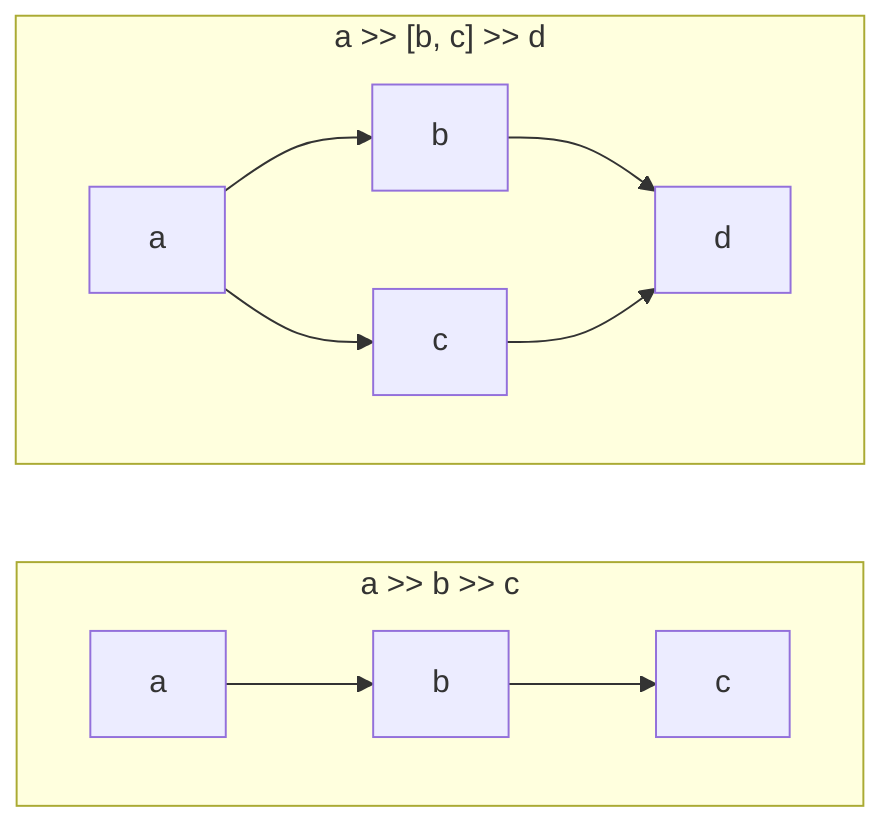
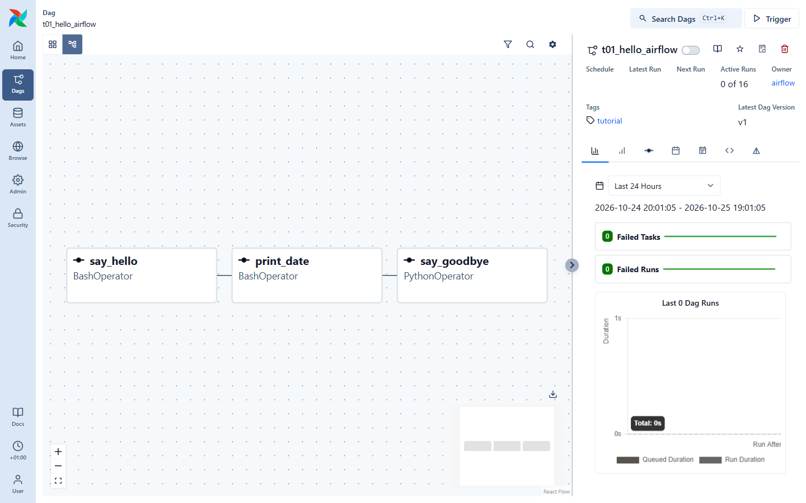
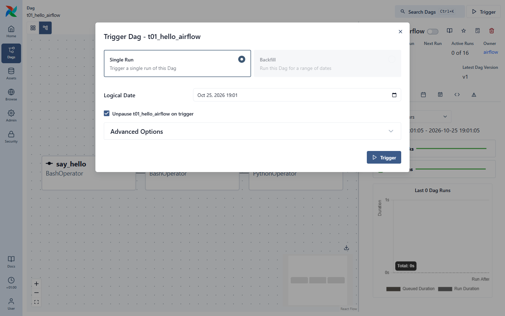
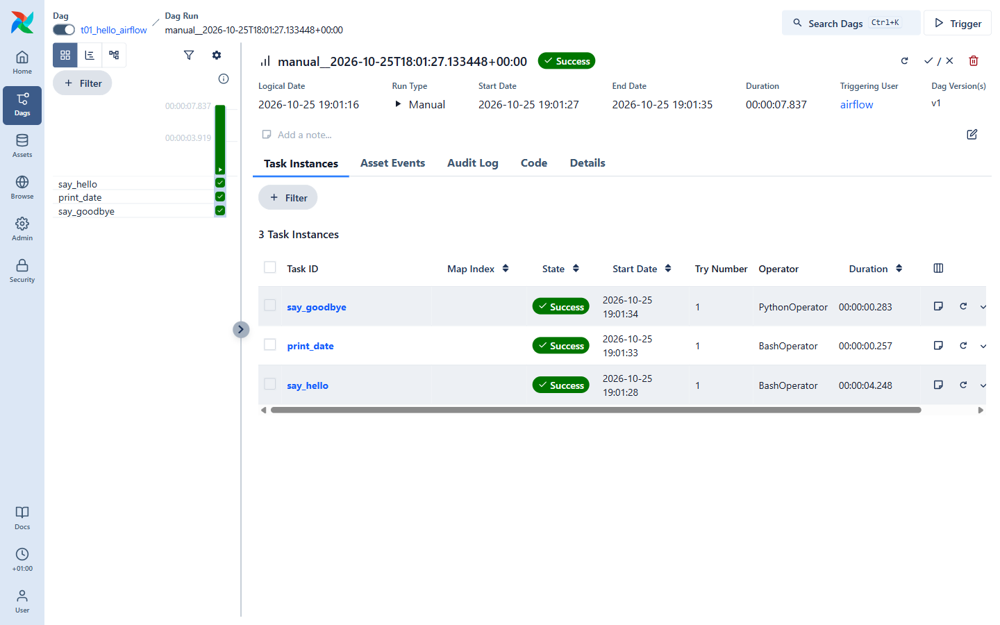
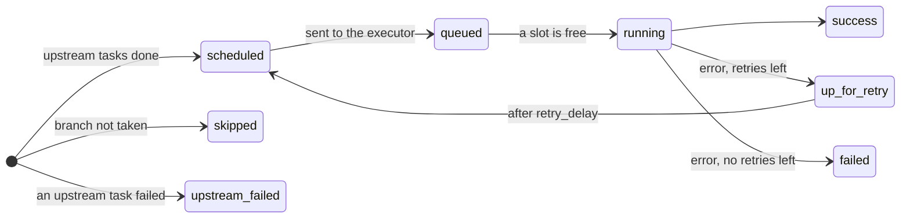
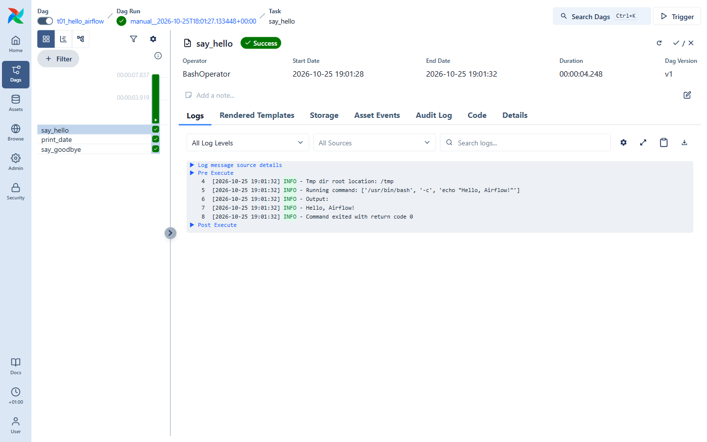

# 03 · Your first DAG

Open [`dags/t01_hello_airflow.py`](../dags/t01_hello_airflow.py):

```python
import pendulum

from airflow.providers.standard.operators.bash import BashOperator
from airflow.providers.standard.operators.python import PythonOperator
from airflow.sdk import DAG


def _say_goodbye():
    print("Goodbye from a Python function! Look for me in the task logs.")


with DAG(
    dag_id="t01_hello_airflow",                               # unique name shown in the UI
    start_date=pendulum.datetime(2026, 1, 1, tz="UTC"),       # first date the DAG is valid
    schedule=None,                                            # only runs when triggered by hand
    catchup=False,
    tags=["tutorial"],
) as dag:
    say_hello = BashOperator(task_id="say_hello", bash_command='echo "Hello, Airflow!"')
    print_date = BashOperator(task_id="print_date", bash_command="date")
    say_goodbye = PythonOperator(task_id="say_goodbye", python_callable=_say_goodbye)

    say_hello >> print_date >> say_goodbye                    # the arrows of the graph
```

Three things make a DAG:

1. **The `DAG` object** – its id, when it starts, how often it runs.
2. **Tasks** – here built from *operators*. Each needs a `task_id` unique within the DAG.
3. **Dependencies** – `a >> b` means "b runs after a succeeds". You can also write
   `a >> [b, c]` (fan-out) or `[b, c] >> d` (fan-in).



In a fan-out, `b` and `c` run **at the same time**; `d` waits for both.

## Look at it in the UI

Go to **Dags → t01_hello_airflow** and switch to the **Graph** view (second icon top-left):



Exactly what the `>>` line described: three boxes, each showing its operator type.

## Run it

Click **▷ Trigger** (top-right). Because `schedule=None`, a manual trigger is the only way to run it.



- **Single Run** – one run now.
- **Logical Date** – the date this run "is about" (more in tutorial 04). Keep the default.
- **Unpause on trigger** – keep it ticked.

Press **Trigger**. Within a few seconds the run goes *queued → running → success*. Refresh the page
if it seems stuck — the run usually finishes in under 10 s.

## The Grid view: your best friend

Switch to the **Grid** view (first icon top-left):



- Each **column** on the left is a DAG run (the bar height is its duration).
- Each **row** is a task. Each little square is a *task instance* coloured by state:
  🟩 success · 🟥 failed · 🟧 up for retry · 🩷 skipped · ⬜ no status yet.
- On the right, the details of the selected run: dates, duration, who triggered it, and its task
  instances.

The life of a task instance, simplified:



## Read the logs

Click a square (or the task name in the right-hand table), e.g. `say_hello`. The **Logs** tab opens:



Everything your task prints ends up here, plus Airflow's own messages (`Running command…`,
`Command exited with return code 0`). Logs are also on disk in `data/logs/`.

## ✍️ Exercise

1. Copy `t01_hello_airflow.py` to `dags/my_first_dag.py`.
2. Change `dag_id` to `my_first_dag` (**every DAG id must be unique!**).
3. Add a fourth task `BashOperator(task_id="list_files", bash_command="ls -la /opt/airflow/dags")`
   and make it run **in parallel** with `print_date`:
   ```python
   say_hello >> [print_date, list_files] >> say_goodbye
   ```
4. Wait ~30 s, find your DAG in the UI, check the graph, trigger it, read the logs of `list_files`.

➡️ Next: [04 · Scheduling & dates](04-scheduling.md)
