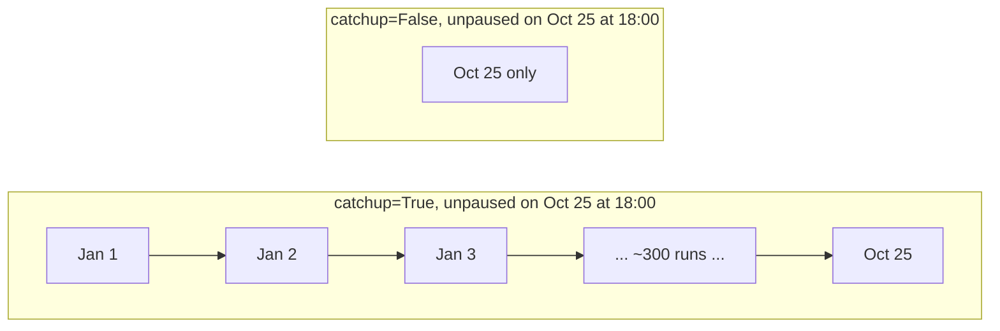
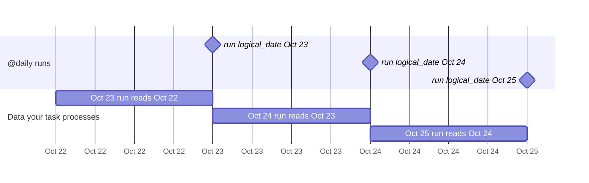

# 04 · Scheduling & dates

So far we triggered DAGs by hand. Most real DAGs run **on a schedule**.
Open [`dags/t02_taskflow_etl.py`](../dags/t02_taskflow_etl.py) and look at the `@dag(...)` arguments:

```python
@dag(
    dag_id="t02_taskflow_etl",
    start_date=pendulum.datetime(2026, 1, 1, tz="UTC"),
    schedule="@daily",
    catchup=False,
)
```

## `schedule`: when to create runs

| Value                       | Meaning                                                     |
| --------------------------- | ----------------------------------------------------------- |
| `None`                      | Never automatically – manual / API triggers only            |
| `"@hourly"`, `"@daily"`, `"@weekly"`, `"@monthly"` | Presets                              |
| `"30 6 * * 1-5"`            | Any cron expression (here: 06:30 on weekdays)               |
| `timedelta(hours=4)`        | Every 4 hours                                               |
| `[some_asset]`              | Whenever that data is updated (tutorial 06)                 |

Tip: [crontab.guru](https://crontab.guru) explains any cron expression in plain English.

## `start_date` and `catchup`

- **`start_date`** – the DAG doesn't exist for dates before this. Always use a fixed date,
  **never `datetime.now()`** (it changes every time the file is parsed!).
- **`catchup`** – if `True`, when you unpause a DAG whose `start_date` is in the past, Airflow creates
  one run **for every missed schedule tick**. With `start_date` = 1 Jan and `@daily`, that's hundreds of
  runs at once. With `catchup=False` (the default in Airflow 3) only the most recent tick runs.



Try it: unpause `t02_taskflow_etl` with its toggle. A run named `scheduled__<today>T00:00:00+00:00`
appears straight away (the most recent midnight) and **not** one per day since January.

## Logical date

Every run carries dates you can use in your tasks. Here is the run we got by unpausing
`t02_taskflow_etl` on 2026-10-25 (straight from the REST API):

| Name                                        | Value                                 |
| ------------------------------------------- | ------------------------------------- |
| `run_id`                                    | `scheduled__2026-10-25T00:00:00+00:00` |
| `logical_date`                              | `2026-10-25T00:00:00+00:00`           |
| `ds`                                        | `"2026-10-25"` (handy string version) |
| `data_interval_start` / `data_interval_end` | both `2026-10-25T00:00:00+00:00`      |

In Airflow 3, a cron schedule like `@daily` is a list of **trigger times**: the run for Oct 25 is
created at Oct 25 00:00, and its `logical_date` is that same moment.



So if a daily job processes "yesterday's" data, compute it from the logical date,
e.g. `logical_date.subtract(days=1)` or `{{ macros.ds_add(ds, -1) }}` in templates.

> 🕰️ **Coming from Airflow 2?** There, `@daily` meant a 24 h *data interval*: the run for
> Oct 24 started on Oct 25 at midnight, and `data_interval_start/end` covered Oct 24.
> Airflow 3 dropped that by default (`[scheduler] create_cron_data_intervals = False`). You can
> get the old behaviour back per DAG with `schedule=CronDataIntervalTimetable("@daily", timezone="UTC")`
> (`from airflow.timetables.interval import CronDataIntervalTimetable`).
> Many older blog posts and Stack Overflow answers assume the Airflow 2 behaviour.

Use these instead of "now" in your tasks. That way, **re-running last Tuesday's run processes last
Tuesday's data** — that's what makes a pipeline idempotent. Our `load` task names its output file
with `ds`:

```python
@task
def load(totals, ds=None):          # Airflow fills in `ds` automatically
    path = OUTPUT_DIR / f"sales_{ds}.csv"
```

Look on your machine: `data/files/sales/sales_<date>.csv` appeared after the run. 🎉

In Bash commands and other templated fields, use Jinja: `bash_command="echo {{ ds }}"`.
The **Rendered Templates** tab of a task instance shows the final command after substitution.

## Backfill: running the past on purpose

Need to (re)process a date range? Click **▷ Trigger → Backfill**, pick a start and end date, and
Airflow creates one run per interval (only for DAGs with a schedule). From the CLI:

```bash
docker compose run --rm airflow-cli backfill create --dag-id t02_taskflow_etl \
  --from-date 2026-10-01 --to-date 2026-10-05
```

## ✍️ Exercise

1. Change the schedule of `t02_taskflow_etl` to run every 5 minutes: `schedule="*/5 * * * *"`.
2. Wait a few minutes and watch new columns appear in the Grid view.
3. Look at `data/files/sales/` – why does it still contain **one file per day**, not one per run?
   (Hint: `ds`.) Then put the schedule back to `"@daily"`.

➡️ Next: [05 · TaskFlow API & XCom](05-taskflow-and-xcom.md)
