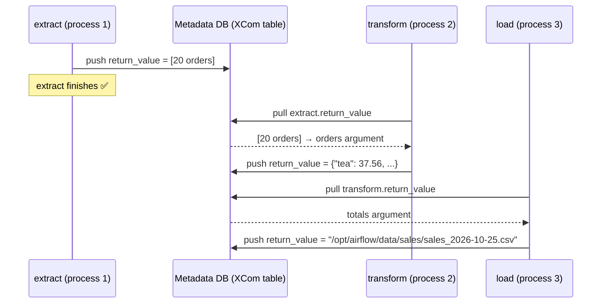
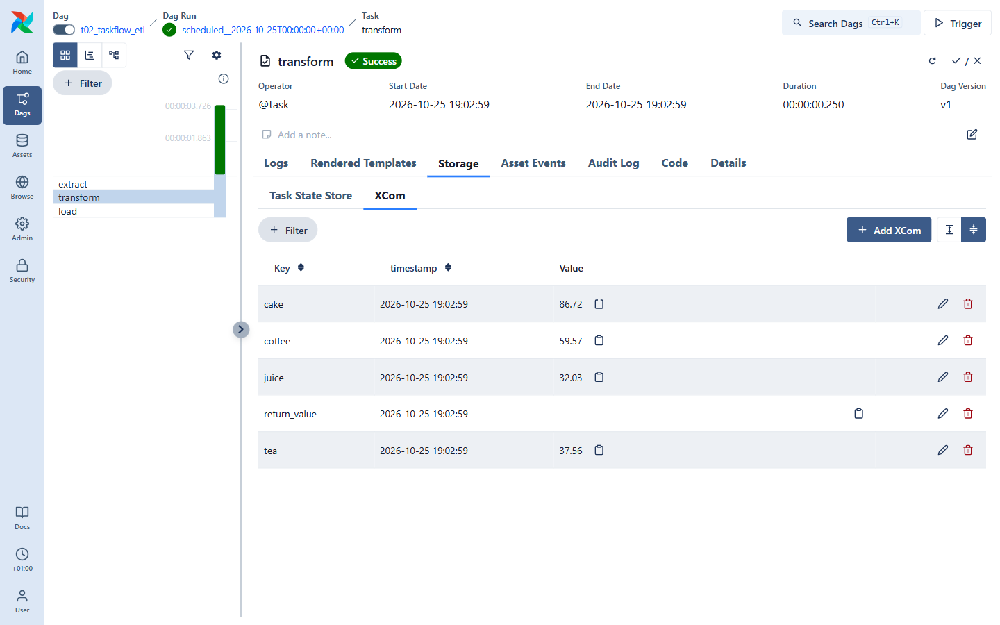

# 05 · TaskFlow API & XCom

In tutorial 03 we built tasks with operators and wired them with `>>`.
The **TaskFlow API** lets you write plain Python functions instead — Airflow figures out the
dependencies from how you call them.

## The ETL DAG, line by line

[`dags/t02_taskflow_etl.py`](../dags/t02_taskflow_etl.py), simplified:

```python
from airflow.sdk import dag, task

@dag(dag_id="t02_taskflow_etl", schedule="@daily", ...)
def taskflow_etl():

    @task
    def extract() -> list[dict]:
        return [{"order_id": 1, "product": "tea", "amount": 4.5}, ...]

    @task
    def transform(orders: list[dict]) -> dict[str, float]:
        ...  # sum per product
        return {"tea": 37.56, "coffee": 59.57, ...}

    @task
    def load(totals: dict[str, float], ds=None) -> str:
        ...  # write a CSV
        return str(path)

    load(transform(extract()))     # <- this line defines extract >> transform >> load

taskflow_etl()                      # <- don't forget to call the DAG function!
```

- `@dag` on a function = a DAG. **Call it at the bottom of the file**, otherwise Airflow sees nothing.
- `@task` on a function = a task. Its `task_id` is the function name.
- Passing the result of one task into another **creates the dependency and passes the data**.

## What actually travels between tasks: XCom

Tasks may run in different processes or even on different machines, so `extract()` doesn't really
hand a Python list to `transform()`. Instead:

1. `extract` finishes and its **return value is stored in the metadata DB** as an XCom
   (key `return_value`).
2. When `transform` starts, Airflow pulls that XCom and passes it as the `orders` argument.



You can see XComs in the UI: open a task instance → **Storage → XCom**.



Notice something? `transform` returned a dict and is annotated `-> dict[str, float]`, so TaskFlow
automatically **also** stored one XCom per key (`cake`, `coffee`, …) next to `return_value`
(that's `multiple_outputs`). Downstream tasks could use `transform(...)["tea"]` directly.

### ⚠️ XCom is for small things

XComs live in the database. Passing a few KB of JSON is fine; passing a 2 GB DataFrame is not.
The usual pattern: **write big data to storage (file, S3, a table) and pass the path** — exactly
what `load` does by returning the CSV path.

## Mixing operators and TaskFlow

Both styles combine freely:

```python
from airflow.providers.standard.operators.bash import BashOperator

@task
def get_file_name() -> str:
    return "report.csv"

show = BashOperator(
    task_id="show",
    bash_command="echo processing {{ ti.xcom_pull(task_ids='get_file_name') }}",
)
get_file_name() >> show
```

There are TaskFlow shortcuts for many operators too: `@task.bash` (return a command string),
`@task.branch` (tutorial 07), `@task.virtualenv`, `@task.docker`…

## Accessing run information

Add any of these names as arguments to a `@task` function and Airflow fills them in:
`ds`, `logical_date`, `data_interval_start`, `data_interval_end`, `params`, `ti` (task instance),
`dag_run`… Or grab everything at once:

```python
from airflow.sdk import get_current_context

@task
def whoami():
    ctx = get_current_context()
    print(ctx["dag_run"].run_id, ctx["ti"].try_number)
```

## ✍️ Exercise

Add a fourth task `notify` after `load` that receives the CSV path and prints
`"Report ready at <path>"`. Hint: `notify(load(transform(extract())))`.
Trigger the DAG and find the path in the `notify` logs **and** in `load`'s XCom tab.

➡️ Next: [06 · Data-aware scheduling with Assets](06-assets.md)
