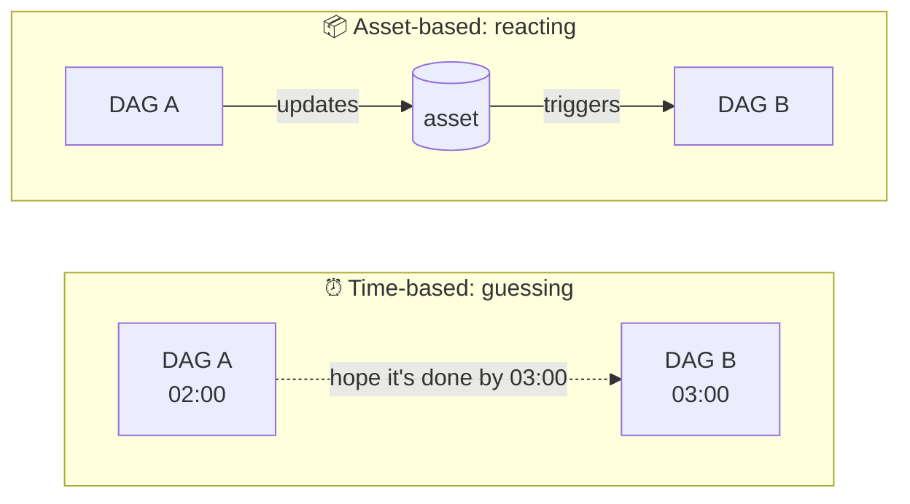
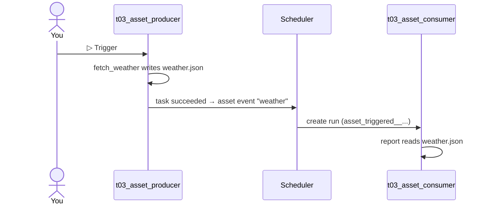
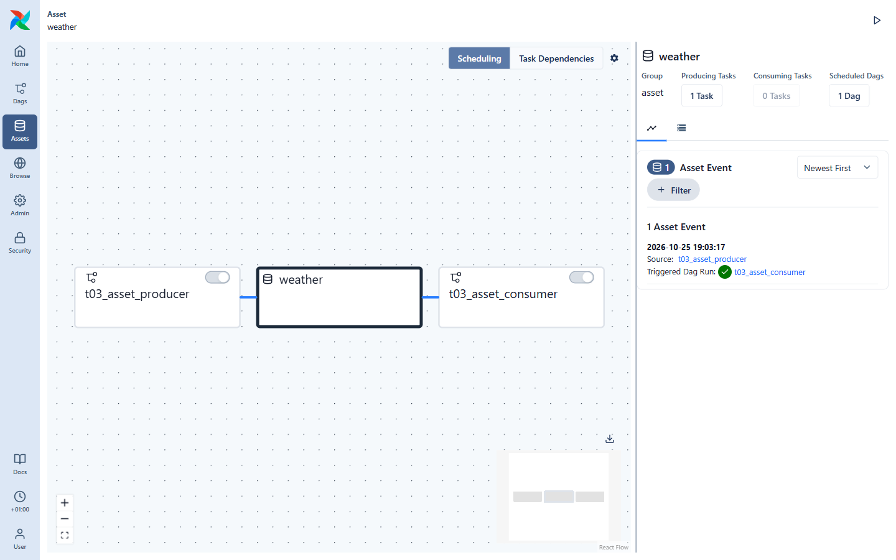

# 06 · Data-aware scheduling with Assets

Time-based schedules have a weakness: if DAG B needs the file produced by DAG A, you end up
guessing ("A runs at 02:00 and usually takes 20 min, so let's run B at 03:00…").

**Assets** fix this: B runs *when A has actually updated the data*.



## The code

[`dags/t03_assets.py`](../dags/t03_assets.py) defines two DAGs in one file:

```python
from airflow.sdk import Asset, dag, task

weather_asset = Asset(name="weather", uri="file:///opt/airflow/data/weather.json")

@dag(dag_id="t03_asset_producer", schedule=None, ...)
def asset_producer():
    @task(outlets=[weather_asset])          # "this task updates the weather asset"
    def fetch_weather():
        WEATHER_FILE.write_text(json.dumps(reading))

@dag(dag_id="t03_asset_consumer", schedule=[weather_asset], ...)   # "run when weather changes"
def asset_consumer():
    @task
    def report():
        reading = json.loads(WEATHER_FILE.read_text())
        ...
```

- `outlets=[asset]` on a task: when the task **succeeds**, Airflow records an *asset event*.
- `schedule=[asset]` on a DAG: a new run is created for each new asset event.


- An asset is just a **name + URI**. Airflow doesn't read or check the file — *you* decide what the
  asset represents (a file, a table, an S3 prefix…).

## Try it

1. Make sure **both** `t03_asset_producer` and `t03_asset_consumer` are unpaused.
2. Trigger `t03_asset_producer`.
3. A few seconds later, `t03_asset_consumer` runs by itself. Its logs say something like
   `Paris: 12.3 C -> take a coat`.

Now open **Assets** in the sidebar and click **weather**:



- The graph shows the lineage: producer DAG → asset → consumer DAG.
- **Asset Events** on the right lists every update, which DAG produced it, and which run it
  triggered (the green ✓ link).

Your file is on your machine too: `data/files/weather.json`.

## Going further

- **Several assets:** `schedule=[asset_a, asset_b]` waits until *both* have been updated
  since the last run. Use `asset_a | asset_b` to run when *either* is updated.
- **Assets + time:** `AssetOrTimeSchedule` runs on a cron *and* on asset updates.
- **Manual events:** the **Create Event** button on the Assets page fakes an update — handy for
  testing consumers without running the producer.

## ✍️ Exercise

Make `t02_taskflow_etl` a producer: add `outlets=[Asset(name="daily_sales")]` to its `load` task,
then write a new DAG `sales_dashboard` with `schedule=[Asset(name="daily_sales")]` and a task that
prints "refreshing the dashboard". Trigger the ETL and watch the dashboard DAG start by itself.

➡️ Next: [07 · Params, Variables & branching](07-params-variables-branching.md)
