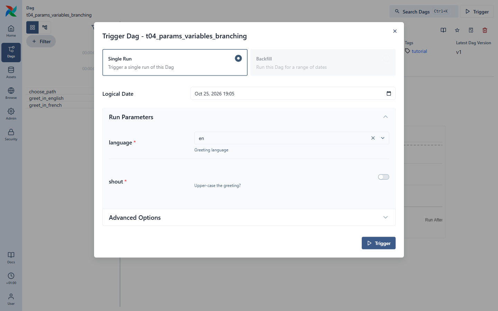
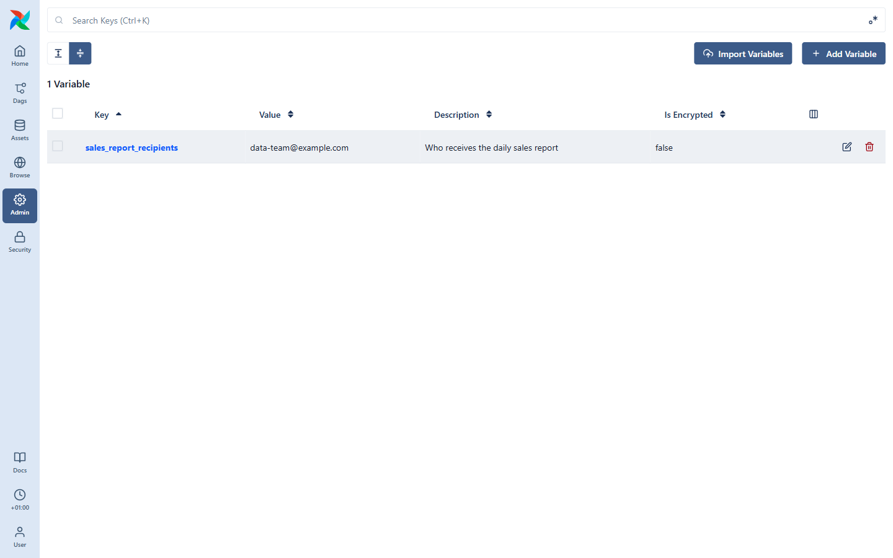
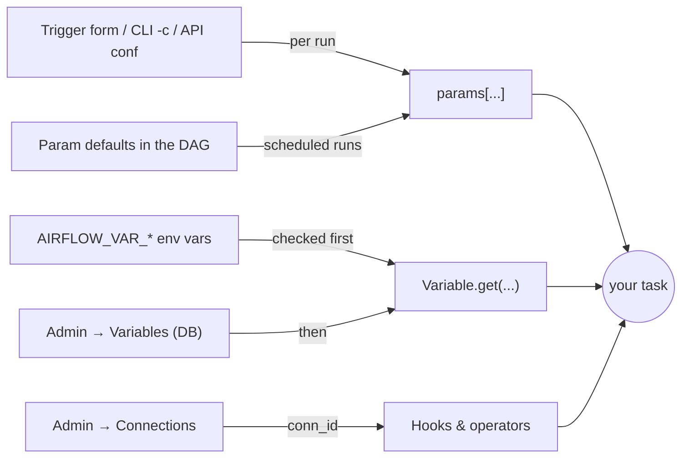
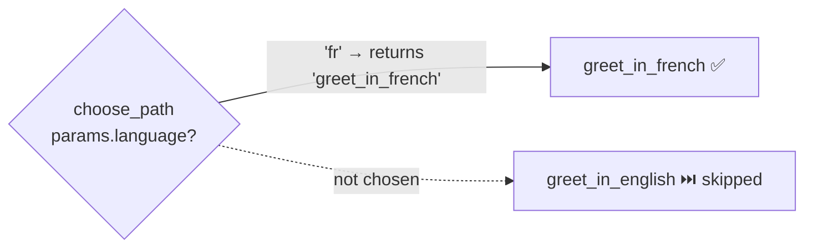
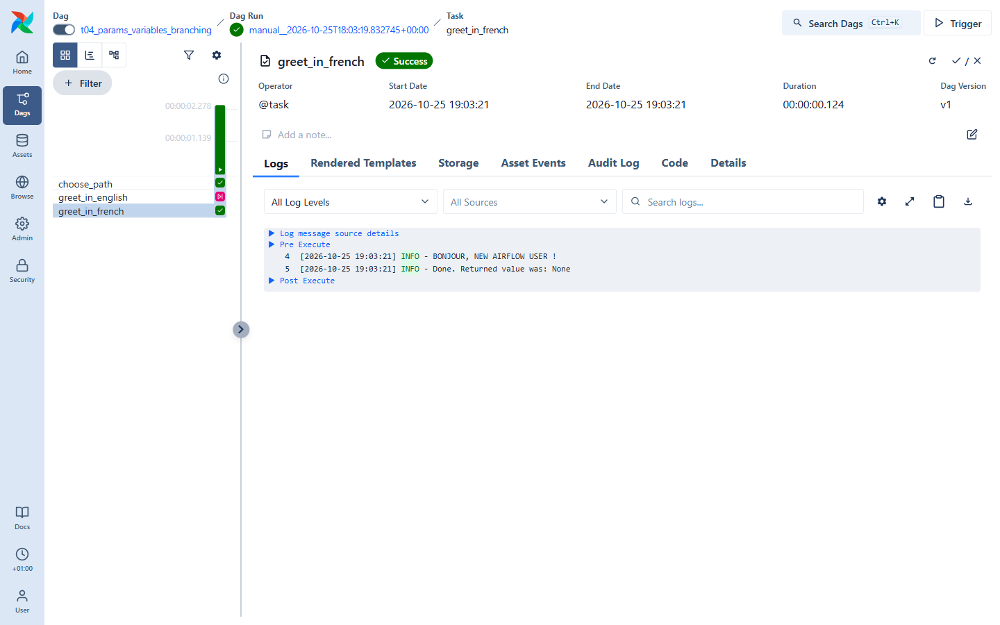

# 07 · Params, Variables & branching

How do you make a DAG configurable, and how do you make it take different paths?
See [`dags/t04_params_variables_branching.py`](../dags/t04_params_variables_branching.py).

## Params: input for a run

```python
@dag(
    ...,
    params={
        "language": Param("en", type="string", enum=["en", "fr"], description="Greeting language"),
        "shout": Param(False, type="boolean", description="Upper-case the greeting?"),
    },
)
```

Params are **per-run** inputs with defaults and validation (JSON Schema). When you click
**▷ Trigger**, Airflow builds a form from them:



Tasks read them through the `params` argument: `params["language"]`.
Scheduled runs simply use the defaults.

From the CLI or API you pass them as JSON:

```bash
docker compose run --rm airflow-cli dags trigger t04_params_variables_branching \
  -c '{"language": "fr", "shout": true}'
```

## Variables: global configuration

**Variables** are key/value settings shared by all DAGs — an email address, a bucket name,
a feature flag. Manage them in **Admin → Variables**:



Read them inside a task:

```python
from airflow.sdk import Variable

name = Variable.get("greeting_name", default="stranger")
```

Variables can also come from **environment variables** named `AIRFLOW_VAR_<KEY>`. That's how
`greeting_name` is defined in our `docker-compose.yaml`:

```yaml
AIRFLOW_VAR_GREETING_NAME: 'new Airflow user'
```

Where values come from, in a nutshell:



Environment-defined variables are **not shown in the UI** (that's why the screenshot only lists
`sales_report_recipients`) but `Variable.get` finds them, and they win over UI values.

> 💡 Read Variables **inside tasks**, not at the top of the DAG file — top-level code runs on every
> parse (every 30 s!) and would hammer the database.

> 🔐 **Secrets** (passwords, tokens) belong in **Connections** (Admin → Connections) or a secrets
> backend, not in Variables or DAG code. Hooks and operators take a `conn_id` and look up the
> credentials for you. Set a `FERNET_KEY` in `.env` to have them encrypted at rest.

## Branching: choosing a path

```python
@task.branch
def choose_path(params=None) -> str:
    return "greet_in_french" if params["language"] == "fr" else "greet_in_english"

choose_path() >> [greet_in_english(), greet_in_french()]
```



A `@task.branch` task **returns the `task_id`(s) to follow**. Every other direct downstream task is
marked **skipped**. Here is a run triggered with `language=fr, shout=true`:



`greet_in_english` is pink (skipped) and the French task printed `BONJOUR, NEW AIRFLOW USER !` —
using both the params and the Variable.

> ⚠️ Skips propagate: a task placed after both branches would be skipped too, unless you give it
> `trigger_rule="none_failed_min_one_success"`. Trigger rules are covered next.

## ✍️ Exercise

1. Add `"de"` to the `enum` and a `greet_in_german` task. Update `choose_path`.
2. In **Admin → Variables**, add `greeting_name` = your name. Trigger the DAG: is your name used?
   (Remember: the environment variable wins. Remove it from `docker-compose.yaml` and run
   `docker compose up -d` to see the UI value take over.)

➡️ Next: [08 · Failures, retries & debugging](08-debugging.md)
