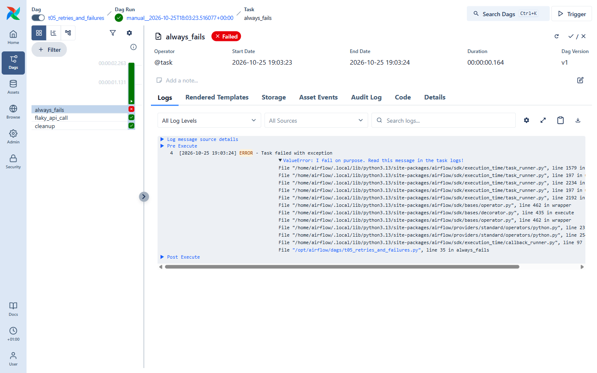

# 08 · Failures, retries & debugging

Things fail: APIs time out, files are missing, code has bugs. Airflow is built for this.
Use [`dags/t05_retries_and_failures.py`](../dags/t05_retries_and_failures.py):

```python
@dag(
    ...,
    default_args={"retries": 3, "retry_delay": timedelta(seconds=10)},   # applies to every task
)
def retries_and_failures():
    @task
    def flaky_api_call():                 # fails ~50% of the time, retried up to 3 times
        if random.random() < 0.5:
            raise ConnectionError("The (pretend) API timed out - Airflow will retry me.")

    @task(retries=0)                      # task-level setting overrides default_args
    def always_fails():
        raise ValueError("I fail on purpose. Read this message in the task logs!")

    @task(trigger_rule="all_done")        # runs whatever happened upstream
    def cleanup(): ...

    [flaky_api_call(), always_fails()] >> cleanup()
```

## Retries

A task that raises an exception is marked **up_for_retry** (🟧) and re-run after `retry_delay`, until
it succeeds or runs out of `retries`. Then it's **failed** (🟥).

Trigger the DAG a few times. Sometimes `flaky_api_call` succeeds first time; sometimes you'll see it
go orange and retry. The task instance shows a **Try Number**, and the Logs tab has one log per try.

Useful retry options: `retry_exponential_backoff=True`, `max_retry_delay`, `execution_timeout`
(fail a task that runs too long).

## Reading a failure

Click the red square of `always_fails`:



The log shows the Python **traceback**. Read it bottom-up: the last `File` line points to
**your** code (`/opt/airflow/dags/t05_retries_and_failures.py, line 35`) and the first line gives the
error (`ValueError: I fail on purpose…`).

## 🤔 Wait, why is the run green?

Look at the breadcrumb: the **DAG run** has a green ✓ even though a task failed. A DAG run's final
state is decided by its **leaf tasks** (the last ones). Our only leaf is `cleanup`, which has
`trigger_rule="all_done"` and succeeded — so the run counts as a success.

Remember this when you add "cleanup" or "notify" tasks at the end of a DAG: they can hide failures.
Common fixes: put cleanup in parallel instead of at the end, or use Airflow's setup/teardown
tasks (`.as_teardown()`), which are ignored when computing the run state.

### Trigger rules cheat sheet

| `trigger_rule`                  | Task runs when…                                       |
| ------------------------------- | ----------------------------------------------------- |
| `all_success` *(default)*       | all upstream tasks succeeded                          |
| `all_done`                      | all upstream tasks finished, whatever the result      |
| `all_failed` / `one_failed`     | all / at least one upstream failed (alerts!)          |
| `one_success`                   | at least one upstream succeeded                       |
| `none_failed_min_one_success`   | nothing failed and at least one succeeded (after branches) |

## Re-running: "Clear"

Fixed the bug? You don't need a new DAG run. Select the failed task instance and click the
**↻ Clear** button (top-right of the task panel). Airflow resets it — and optionally its downstream
tasks — and the scheduler runs it again **with the same dates**. You can clear a whole run too.

Also handy: **Mark as success / failed** (the ✓/✗ button) to unblock a run manually.

## Debugging toolbox

```bash
# Is my DAG file even importing?
docker compose run --rm airflow-cli dags list-import-errors

# Run a whole DAG once in a single process, printing all logs to your terminal.
# Doesn't need the scheduler - perfect for fast iteration.
docker compose run --rm airflow-cli dags test t05_retries_and_failures

# Run a single task
docker compose run --rm airflow-cli tasks test t02_taskflow_etl extract 2026-10-25

# Follow a service's logs
docker compose logs -f airflow-scheduler
docker compose logs -f airflow-dag-processor     # DAG parsing errors appear here

# Open a shell inside the Airflow image
docker compose exec airflow-scheduler bash
```

Task logs are also plain files in `data/logs/dag_id=…/run_id=…/task_id=…/attempt=N.log`.

## ✍️ Exercise

1. Change `always_fails` so it **succeeds** (comment out the `raise`). Wait 30 s for the new
   DAG version.
2. In the Grid, select the old failed `always_fails` square and **Clear** it. Watch it turn green.
3. Make the run turn **red** when a task fails: change `cleanup`'s trigger rule back to the default
   and trigger again. What happens to `cleanup` now?

➡️ Next: [09 · Cheat sheet & next steps](09-cheatsheet.md)
